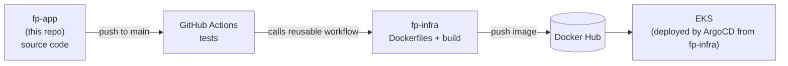

# fp-app

Application source code for **IPLTB** — an Israeli Premier League predictions app.

This repository contains **only the application code**. Everything needed to build, deploy and run it — Dockerfiles, Helm chart, ArgoCD, Terraform (AWS VPC, EKS, RDS) and monitoring — lives in the infrastructure repository:

> **Infrastructure: [matanmou/fp-infra](https://github.com/matanmou/fp-infra)**



## Components

| Directory | Description | Stack |
|---|---|---|
| `frontend/` | Web UI — team list, picks, predictions | Angular 22, served by nginx |
| `backend/` | REST API under `/ipl-predict` | NestJS 8, TypeORM, MySQL |

### Backend API

| Method | Path | Description |
|---|---|---|
| `GET` | `/ipl-predict/teams` | List all teams |
| `GET` | `/ipl-predict/picks` | List all picks |
| `GET` | `/ipl-predict/picks/:id` | Get a single pick |
| `POST` | `/ipl-predict/picks` | Create a pick |
| `GET` | `/metrics` | Prometheus metrics (internal, scraped by Prometheus) |

### Database

The schema and the teams reference data are versioned as TypeORM migrations in `backend/src/migrations/` and are applied automatically when the backend starts (disable with `DB_MIGRATIONS_RUN=false`). `synchronize` is off — schema changes go through migrations only.

## Configuration

The backend is configured through environment variables:

| Variable | Description |
|---|---|
| `DB_HOST` | MySQL host |
| `DB_PORT` | MySQL port (usually `3306`) |
| `DB_NAME` | Database name |
| `DB_USER` | Database user |
| `DB_PASSWORD` | Database password |
| `DB_MIGRATIONS_RUN` | Set to `false` to skip migrations on startup |
| `PORT` | HTTP port (default `3000`) |

The frontend's nginx proxies `/ipl-predict/` to the backend using `BACKEND_URL` (see `frontend/nginx/default.conf.template`).

In Kubernetes these values are set by the Helm chart in [fp-infra](https://github.com/matanmou/fp-infra/tree/main/Helm/ipltb).

## Running locally

Requirements: Node.js 22+, a MySQL 8 instance.

**Backend**

```bash
cd backend
npm install
export DB_HOST=127.0.0.1 DB_PORT=3306 DB_NAME=ipldb DB_USER=<user> DB_PASSWORD=<password>
npm run start:dev          # http://localhost:3000
```

**Frontend**

```bash
cd frontend
npm install
npm start                  # http://localhost:4200
```

**Tests**

```bash
cd backend  && npm test
cd frontend && npm test -- --watch=false
```

## CI/CD

Workflows in `.github/workflows/` run on every push to `main`, separately per component (path filters on `backend/**` and `frontend/**`):

1. **Test** — install dependencies and run the unit tests.
2. **Deploy via fp-infra** — call the reusable workflow in `fp-infra`, which builds the Docker image from `fp-infra/Docker/<component>` (the Dockerfile clones this repo) and pushes it to Docker Hub:
   - `matanmo93/fp-backend:<commit-sha>` / `:latest`
   - `matanmo93/fp-frontend:<commit-sha>` / `:latest`
3. **Deploy to the cluster** — ArgoCD syncs the Helm chart in `fp-infra` to EKS.

Required repository secret: `DOCKERHUB_TOKEN`.

## Related

- Infrastructure, deployment and monitoring: [matanmou/fp-infra](https://github.com/matanmou/fp-infra)
